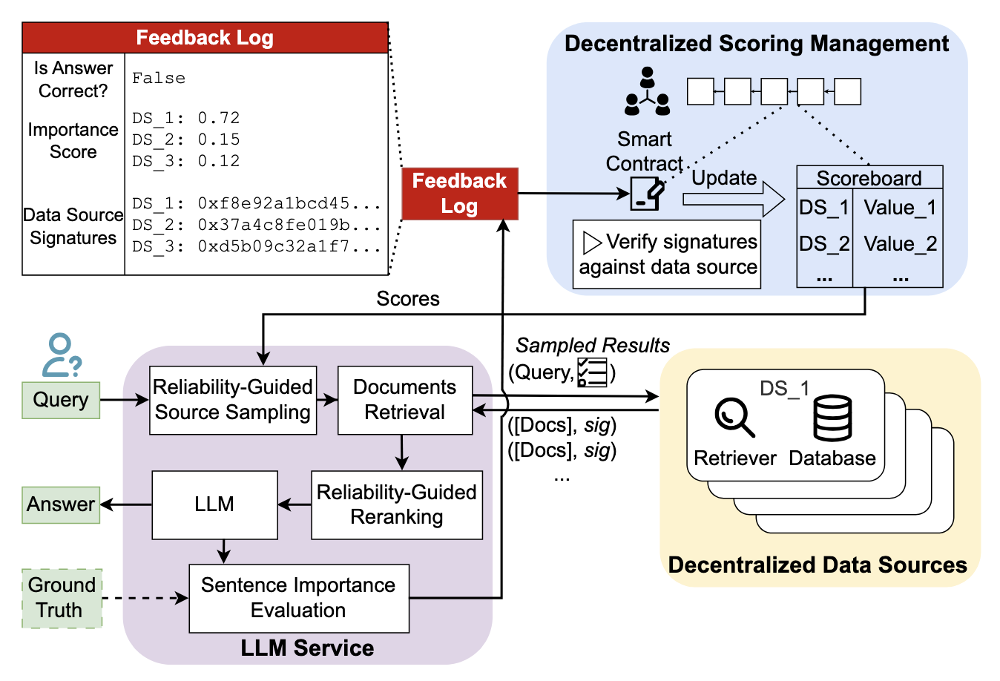

# A Decentralized Retrieval Augmented Generation System with Source Reliabilities Secured on Blockchain

<p align="center">
  
  
  
</p>

<p align="center">
  <b>TL;DR: We built dRAG, a decentralized RAG system that addresses data reliability challenges in real-world settings </b><br>
  <a href="https://arxiv.org/abs/2511.07577"><b>Paper on arXiv</b></a>
</p>

---

## 🎓 About this fork (thesis)

This repository is a fork of [Reliable-dRAG](https://github.com/yining610/Reliable-dRAG) used in an undergraduate thesis, **"Exploring Privacy-Preserving Approaches for Large Language Models"** (supervisor: Dr. Swakkhar Shatabda).

We do **not** modify Reliable-dRAG's retrieval or scoring logic. We add a security evaluation layer on top of it: attack modules that probe the system through its existing HTTP and blockchain interfaces, as an external adversary would. Reliable-dRAG is the second system in a generalizability study. The first is DRAG (Xu et al., 2025), a peer-to-peer gossip-based distributed RAG, on which the same framework was built and validated.

The thesis claim is that **one structured CIA-triad framework (six attacks, two per property) applies across structurally different distributed-RAG architectures.** Reliable-dRAG also has something DRAG does not: an on-chain reliability score (`R_i` / `U_i`) that decides which source is trusted, which gives the Source Selection Manipulation attack a concrete target.

Attacks are the primary deliverable. Defenses for several of them were added afterwards and are documented separately (see [Defenses](#-defenses)).

---

## ⚙️ System Overview
Our dRAG system can be abstracted into three components: *Decentralized Data Sources*, *LLM Service*, and *Decentralized Blockchain Network*. Details can be found in Section 5 of the paper.

<p align="center">
  
</p>

## 🚀 How to Deploy dRAG?
We provide detailed instructions for starting the [retrieval service](drag_data_source/README.md), [LLM service](drag_llm_service/README.md), and interacting with the [smart contract](drag_python_client/README.md). For your convenience, we also provide a one-line command to launch the entire dRAG system.

### Quick Start (One-Line Command)
To start all services using Docker Compose:

```bash
docker compose up -d
```

By default, the LLM image skips vLLM (GPU-only). To enable it:
```bash
INSTALL_VLLM=true docker compose up --build -d
```

If you use a gated HuggingFace model (e.g., Llama), set your token first:
```bash
HF_TOKEN=hf_your_token_here docker compose up --build -d
```

This will:
1. Start the contract service (a smart contract deployed on local Hardhat node for testing)
2. Start all three data sources simultaneously (data-source-0, data-source-20, data-source-100, each is assigned with a testing private key provided by Hardhat)
3. Start the LLM service after all data sources are healthy. The LLM service will also have a private key.

To view logs:
```bash
docker compose logs -f
```

To stop all services:
```bash
docker compose down
```

### Testing the System
Once all Docker containers are up and running, you can use the `test.ipynb` Jupyter notebook to interact with the system. The notebook contains:
- Health check tests for all services
- Example queries to test the RAG system
- Integration tests to verify the end-to-end functionality
or check Reliable-dRAG-anonymous/drag_llm_service/README.md for endpoint description.

To use the notebook:
```bash
jupyter notebook test.ipynb
```

Make sure all services are healthy before running the tests. You can check the service status with:
```bash
docker compose ps
```

If you wish to test the system with publicly smart contract, there is an example deployment on Sepolia (a public Ethereum testnet) at [0x5F67901BC1A22010BA438EDa426A70d0B5eA17Be](https://sepolia.etherscan.io/address/0x5F67901BC1A22010BA438EDa426A70d0B5eA17Be). A private key of Sepolia wallet and Infura api key are needed to connect to the testnet.

### Example Visualization
The dRAG system provides real-time monitoring of source scores (usefulness and reliability) over queries.

<p align="center">
  
</p>

The visualization demonstrates how the system learns and adapts to source quality over time, with sources showing different performance characteristics based on their pollution levels and content quality.

## 📖 Folder Structure
```
data/                 // Synthetic polluted datasets for experiments
drag_contract/        // Hardhat project + Solidity DragScores contract
drag_data_source/     // Dockerized retrieval service
drag_llm_service/     // Dockerized LLM orchestrator service
drag_python_client/   // Minimal Python client for DragScores
result/               // Result example for live visualization
attack/               // Security evaluation framework: six CIA-triad attack modules
defense/              // One folder per defended attack, plus an index (defense/README.md)
config/               // YAML configs for the config-driven (sim/sweep) attack + defense modules
attack_logs/          // Created at run time: output of each attack run (git-ignored)
defense_logs/         // Created at run time: output of each defense run (git-ignored)
```

---

## 🛡️ Security Evaluation Framework

Each CIA property has two attacks that target structurally distinct mechanisms.

| Property | Attack | Mechanism | Module |
|---|---|---|---|
| Integrity | **Data Poisoning** | Data plane: injects malicious or misleading documents into a source's own retriever | [`attack/datapoisoning/`](attack/datapoisoning) |
| Integrity | **Source Selection Manipulation (SSM)** | Control plane: manipulates the on-chain reliability score that decides which source is trusted | [`attack/ssm_score/`](attack/ssm_score) |
| Confidentiality | **KB Extraction** | Content: reconstructs a source's private documents with keyword-level probes (never exact stored text) | [`attack/kb_extraction/`](attack/kb_extraction) |
| Confidentiality | **Membership Inference (MIA)** | Presence: infers whether a given record is in a source, using paraphrased probes | [`attack/Mia_attack/`](attack/Mia_attack) |
| Availability | **Denial of Service (DoS)** | Overt resource exhaustion: a congestion simulation and a real concurrent flood | [`attack/ddos_sim/`](attack/ddos_sim) |
| Availability | **Selective Forwarding** | Covert insider withholding: a trusted source silently drops a fraction of queries | [`attack/selective_forward_sim/`](attack/selective_forward_sim), [`attack/selective_forward/`](attack/selective_forward) |

### Before running anything

1. Start the stack (`docker compose up -d`, see above) and wait until `docker compose ps` shows every service healthy. This starts three data sources, the LLM service, and a local Hardhat node with the contract pre-deployed.
2. Run a **clean baseline** (no attack) first and record F1 / accuracy so every attack has a ground truth to compare against.
3. Install the Python requirements for the attack scripts on the host: `pip install -r requirements.txt` (and `requirements_squad.txt` for the SQuAD-based evaluations).
4. The data sources rate-limit to 60 requests per minute per IP by default. Attacks that issue many queries (KB extraction, MIA) are slowed by this; that is part of the system under test, so leave it unless a script says otherwise.
5. Results are written to `attack_logs/`. Use **seeds 0, 42 and 123 and report mean ± std**; single-seed numbers are not final.
6. The Hardhat chain is in-memory and is re-created on every container restart. Restart `hardhat-node` (or the whole stack) to undo any on-chain score drift an SSM run produced.

### Running each attack

```bash
# Integrity: Data Poisoning (light | medium | heavy intensity)
python attack/datapoisoning/run_attack.py --evaluate --intensity heavy --seed 42
python attack/datapoisoning/run_all_attacks.py --seeds 0 42 123 --intensities light medium heavy
python attack/datapoisoning/run_attack.py --reset            # restore the poisoned source

# Integrity: SSM
python attack/ssm_score/run_grounding_farming.py             # flagship: no privileged access, queries like a normal user
python attack/ssm_score/run_attack.py                        # secondary: orchestrator key-forgery variant

# Confidentiality: KB Extraction
python attack/kb_extraction/run_attack.py                    # fixed-probe baseline over the retrieval + LLM endpoints
# adaptive keyword-snowball crawlers (attack/kb_extraction/adaptive_attack.py) are driven by the
# defense evaluation: python defense/kb_extraction_defense/evaluation/live_eval.py --source 1

# Confidentiality: Membership Inference (report AUC-ROC)
python attack/Mia_attack/run_attack.py --seed 0              # repeat with --seed 42 and --seed 123

# Availability: DoS
python attack/ddos_sim/run_attack.py --mode mock             # congestion simulation, no stack needed
python attack/ddos_sim/run_attack.py --mode live --n_questions 30
python attack/ddos_sim/run_live_evaluation.py --num_questions 10   # real concurrent flood, quality degradation

# Availability: Selective Forwarding
python attack/selective_forward_sim/run_attack.py --mode mock
python attack/selective_forward_sim/run_attack.py --mode live --n_questions 50
python attack/selective_forward/run_attack.py --mode sweep --n_questions 50   # dropper on the live stack
```

Each script has `--help` for its full flags (targeting strategy, attack ratio and intensity, seeds, URLs), and several modules have their own `README.md`.

| Attack | Needs the Docker stack | Typical output |
|---|---|---|
| Data poisoning | yes | F1 / EM before vs after, per intensity |
| SSM | yes (blockchain + LLM service) | score trajectory, usage share of the malicious source |
| KB extraction | yes | extraction rate, topic coverage, CRR / SS / EED on the LLM channel |
| MIA | yes | AUC-ROC per seed |
| DoS | `mock` no, `live` yes | hit rate and answer quality vs fraction of sources removed |
| Selective forwarding | `mock` no, `live` yes | hit rate vs drop ratio and strategy |

---

## 🧱 Defenses

Defenses are an extension beyond the original attack-only scope and cover a subset of the attacks. Each has one folder with a single README containing the design, the before/after results and its limitations. The index and layout convention are in [`defense/README.md`](defense/README.md).

| Attack | Defense folder | Run |
|---|---|---|
| Data poisoning | [`defense/datapoisoning_defense/`](defense/datapoisoning_defense) | `python defense/datapoisoning_defense/run_defense.py --seed 42 --intensity heavy` |
| SSM | [`defense/ssm_defense/`](defense/ssm_defense) | `python defense/ssm_defense/evaluation/run_defense.py` (replays the attack on-chain; restart `hardhat-node` afterwards) |
| KB extraction | [`defense/kb_extraction_defense/`](defense/kb_extraction_defense) | `python defense/kb_extraction_defense/evaluation/offline_eval.py all --source 1`, then `.../evaluation/live_eval.py --source 1` |
| MIA | [`defense/mia_defense/`](defense/mia_defense) | `python defense/mia_defense/run_defense.py --seed 0` |
| DoS | [`defense/ddos_sim_defense/`](defense/ddos_sim_defense) | `python defense/ddos_sim_defense/run_defense.py --mode mock` |
| Selective forwarding | [`defense/sfa_sim_defense/`](defense/sfa_sim_defense), [`defense/sfa_defense/`](defense/sfa_defense) | see each README |

The KB-extraction and SSM defenses are wired into the data sources and LLM service and are on by default (the grounding verifier in the SSM defense is disabled; its README explains why). Set `EXTRACTION_GUARD_ENABLED=0` to run the data sources without the extraction guard when you need the undefended behaviour.

<!-- ## 📚 Citation
If you use our code or system, please cite the following paper:
```

``` -->
